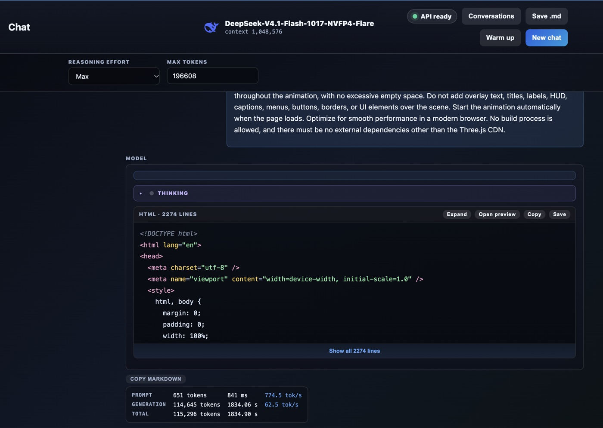
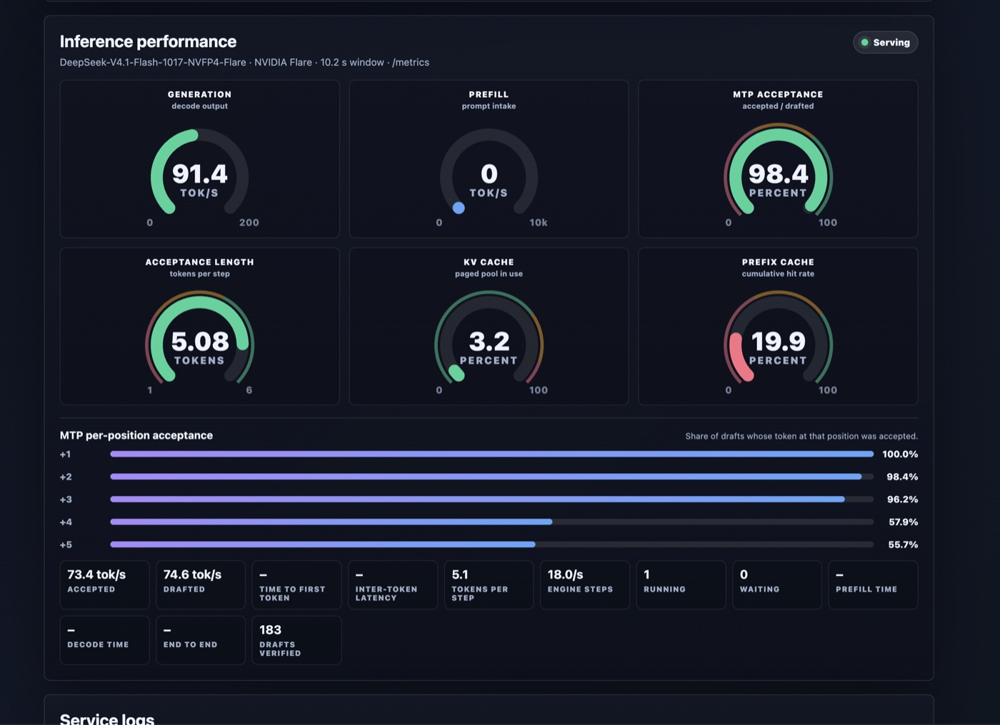

<p align="center">
  
</p>

# DeepSeek-V4.1-Flash-1017 on NVIDIA Flare, four DGX Sparks

A recipe that serves DeepSeek's official weights,
[`deepseek-ai/DeepSeek-V4.1-Flash-1017`](https://huggingface.co/deepseek-ai/DeepSeek-V4.1-Flash-1017)
(MXFP4 routed experts, FP8 Engram tables, loaded as published), with [NVIDIA Flare](https://github.com/NVIDIA/flare-local-inference) at tensor
parallelism 4 on four NVIDIA DGX Sparks (GB10) cabled as a **switchless QSFP
ring**. Ignition prepares a signed runtime package once; the Helios runtime then
runs one rank per Spark, with RoCEnante collectives on the ring cables. 1M-token
context, thinking on by default, tool calls, images, and video (as frames). The
API is OpenAI-compatible.

The same model on the same four Sparks under vLLM is
[calvarado2004/deepseek-v41-1017-nvfp4](https://github.com/calvarado2004/deepseek-v41-1017-nvfp4)
(LibertAIDAI's NVFP4 transcode of these weights).
Flare is faster for one request and for four.

| Measured, one stream unless noted (tok/s) | Flare `085ae4a7`, driver 615 (2026-10-30) | Flare `bce032c`, driver 580 (2026-10-25) | Flare `5f37bd1`, LibertAIDAI NVFP4 (2026-10-22) | vLLM recipe |
|---|---:|---:|---:|---:|
| Count to 100 (median of 3; runs) | **133.5** (134.2 / 129.7 / 133.5) | 129.2 (120.3 / 129.2 / 129.7) | 98.1 | 81 |
| Code (median of 3; runs) | **109.9** (109.9 / 108.2 / 114.1) | 109.3 (91.1 / 110.2 / 109.3) | 89.3 | 75 |
| Prose, English (median of 3; runs) | **61.4** (61.3 / 61.4 / 61.6) | 57.5 (57.2 / 59.6 / 57.5) | 41.6 | 32 |
| Prose, Spanish (median of 3; runs) | **60.6** (62.3 / 60.2 / 60.6) | 54.4 (54.4 / 54.0 / 55.5) | 43.9 | – |
| Two prose streams, aggregate | **92.0** (46.0 + 50.2) | 87.0 (43.6 + 45.2) | 66.8 | – |
| `code_bench`, 1 stream (median of 3; runs) | **94.3** (94.3 / 93.9 / 94.7) | 91.9 (95.2 / 91.9 / 89.5) | 73.8 | 61.2 |
| `code_bench`, 4 streams, aggregate (median of 3; runs) | **186.0** (157.9 / 186.0 / 187.3; 46.5 per stream) | 160.2 (160.2 / 159.4 / 172.0; 40.0 per stream) | 84.4 | 126.4 |
| Cold prefill, 20K tokens (tok/s) | 3,621 | **3,737** | 3,344 | ~3,500 |

`bench.py` rows: 350-word answers at temperature 0, low effort, 3 runs, on an idle
card. `code_bench` rows: eight coding tasks, 512 tokens each (`ignore_eos`),
thinking off, temperature 0. Same settings in all Flare columns: adaptive DSpark verification, the
Engram row cache at 6G, and the rendezvous on the fabric (see "Three settings
that decide the speed"). The `085ae4a7` column is the current recipe: `bce032c`
plus one upstream change, FlashInfer `43eaf93f` (packed MLA and native MXFP4 MoE
kernels), and a new export of the same weights.

Why `085ae4a7` and not a newer pin: on code, a decode round (the target model
verifies the drafts) takes 40.8 ms on the GPU instead of 43.2 ms, and DSpark
still accepts 78% of the drafts (`tests/profile-decode.py`, 3 code requests).
Upstream `eb71702b` (2026-10-28) had the same faster rounds, but code accepted
74% and gave 9% fewer tokens per round: 98.9 tok/s on code. The long-context,
chat and quality results below were measured on `bce032c`.

**Long context** (`bce032c`, one stream, thinking off, a 400-word story after
the context):

| Context | Prefix cache | First token | Decode |
|---|---|---:|---:|
| 16 tokens | – | 0.2 s | 48.5 tok/s |
| 99,347 tokens | cold | 24.1 s | 44.7 tok/s |
| 299,527 tokens | 299,512 cached | **0.4 s** | **46.7 tok/s** |
| 299,514 tokens, cold prefill | – | 78.3 s | – |

A real chat request on `bce032c` (thinking on, effort Low, 75-token prompt: RSUs
vs stock options, with a four-year vesting table) generated **13,831 tokens in
215.6 s: 64.1 tok/s**, first token in 329 ms.

## Real work: one prompt, one shot

<p align="center">
  
</p>

A single request: a long spec for a **futuristic neon city at night in the rain**
in three.js (thousands of lit windows, holographic billboards, wet reflective
streets, rain, flying-car lanes, fog, and an exact 60-second camera
flythrough), reasoning effort **Max**. The model wrote a 2,274-line page that
runs as is. [`examples/neon-city/`](examples/neon-city/) has the untouched HTML
and a 63-second recording.

| One request, 651-token prompt | |
|---|---:|
| Generated | **114,645 tokens in 30.6 min — 62.5 tok/s average** |
| First token | 841 ms |

<p align="center">
  
  
</p>

The dashboard (right, from a code request on the same card) shows what DSpark
does on code: 5.08 tokens per step and 96–100% acceptance on the first three
draft positions. Free reasoning at temperature 1.0 drafts less well, so the
average over a long Max-effort request is lower than the code-phase peak.

## Quality

| Check (official weights, 2026-10-25) | Result |
|---|---|
| `tests/smoke.py` (6 checks) on `085ae4a7` and on `bce032c` | 6/6 |
| Long agent session stays warm (`qualify/prefix_retention.py`, patch 0008, `bce032c`): a 299.5K-token conversation, then 64 three-turn side conversations (554 snapshot evictions), then a follow-up turn | **299,522 tokens cached, first token in 0.6 s**, recalls the code from the first message |
| Count to 100, 3 runs | exact 3/3 |
| Deduction puzzle | correct ("dog"), 4,548 tokens, no loops, no foreign script |
| Tool calls, listed and deferred, stream and non-stream | pass |
| Needle in a haystack at 81,920 / 262,144 / 524,288 / 955,000 tokens | found at every length |
| Images, the vLLM recipe's 44-image set (count, OCR, color, chart, spatial, multi-image) | **44/44** |
| Video, a moving object (TLS front frames) | pass |
| Finished reply while another request decodes (the check that came with the earlier patch 0005, upstream since `a7d51ca1`) | pass on `5f37bd1`: the short reply closed 2 ms after its last token while an 8,192-token reply kept decoding |
| Qwen Code, a small car-dealership Python project (LibertAIDAI weights, 2026-10-22) | 18 tool calls, 6 modules, **36/36 tests pass** |
| Long agent session, 401 messages (then patch 0006, upstream since `67ba265e`; LibertAIDAI weights) | first token in 0.3 s with the prefix cache; cold 69.7 s for 41.7K tokens |

## Hardware

- 4 × DGX Spark (GB10, 128 GB unified memory). Rank 0 needs about 1 TB free
  disk: the checkpoint (475 GiB) and the package (474 GiB). Ranks 1–3 need
  about 261 GiB (280 GB) each: the first start writes their rank of the package
  and the shared data into their own model cache.
- Four QSFP cables in a ring: rank 0 → 1 → 2 → 3 → 0, each cable on its own
  /24. The vLLM recipe's README describes the cabling and addresses we use.
- **NVIDIA driver 615.71.09** on every node. All the `085ae4a7` numbers were
  measured with it. DGX OS ships R580 (580.178.04), the only driver that NVIDIA
  validates on DGX Spark. On R580, an export of a Flare pin that includes
  `cb6187bf` (2026-10-27) fails in "Warm compiled forwards" with
  `Xid 13 ... Illegal Instruction Encoding` ([Flare issue #137](https://github.com/NVIDIA/flare-local-inference/issues/137));
  on 615 the same exports pass. `085ae4a7` comes before `cb6187bf`, but this
  recipe is measured only on 615. See [Driver 615](#driver-615).
- Ubuntu with CUDA 13.3 (`scripts/build-flare.sh` installs `cuda-toolkit-13-3`
  if missing), and one account (`SPARK_USER`) with passwordless sudo and SSH
  between the nodes. No Docker.

### Driver 615

Ubuntu 24.04 `noble-updates` has the driver and prebuilt kernel modules signed
by Canonical for the DGX OS kernel (7.0.0-1019-nvidia): no DKMS, and Secure Boot
stays on. Stop every model, then on each node:

```bash
sudo apt-get install --no-install-recommends nvidia-driver-615-open \
  "linux-modules-nvidia-615-open-$(uname -r)" linux-modules-nvidia-615-open-nvidia-hwe-24.04
sudo reboot
```

`--no-install-recommends` keeps apt from adding DKMS. After the reboot,
`nvidia-smi` shows 615.71.09 and CUDA 13.4, and `dmesg` has one new line,
`NV_ERR_NOT_SUPPORTED` from `koobInitAperture`, which is harmless. Do one node
first: a card with one node on 615 and three on 580 served and passed
`tests/smoke.py`. To go back, install `nvidia-driver-580-open` and the two 580
module packages, then reboot.

## What the stack is

| Layer | Choice |
|---|---|
| Engine | Flare `085ae4a7` (main, 2026-10-25: `bce032c` + FlashInfer `43eaf93f`) + 4 patches (`patches/`), built from source on each node |
| Driver | NVIDIA 615.71.09 (see [Driver 615](#driver-615)) |
| Package | `ignition export` at TP=4 with `--roce-ring`, max concurrency 4, 5 DSpark drafts, prefill chunk 4,096, csf expert-scale compression |
| Experts | MXFP4, as DeepSeek publishes them (Flare's stock deepseek41 recipe) |
| Engram tables | FP8 E4M3 rows, as published; read from NVMe through a 6G row cache |
| Speculative decoding | DSpark, 5 drafts, adaptive verification (package default) |
| Processes | one systemd unit per rank in Flare's documented manual mode (`docs/multi-host.md`, "Start ranks manually"): rank 0 serves the export's cache entry and sends each peer its ranges at the first start; each rank logs to its own journal |
| Prefix cache | 256 GPU snapshot slots (`--prefix-cache-snapshots`, patch 0008) instead of 32, evicted by recompute cost |
| HTTPS | `bin/tls-front.py`: TLS 1.2+ on :8888 in front of Flare's plain HTTP on 127.0.0.1:8001 |
| Warm start | 71 s from start to serving (patch 0009); the first start after an export about 10 minutes |
| Logs | one `req`/`end` line per request in rank 0's journal, and a flight recorder on every rank (see [Logs](#logs)) |
| Crash recovery | a crash of the serving card restarts all four ranks, at most 3 times in 24 h (see [Crash recovery](#crash-recovery)) |
| Video | the TLS front turns `video_url` parts into timestamped JPEG frames (`bin/dsv41_video_frames.py`, the vLLM recipe's module) |

### The patches

| Patch | Why |
|---|---|
| 0004 | A request with `tool_choice: "required"` that asks for no thinking mode is encoded in chat mode. Flare thinks by default, so these requests got HTTP 400 "thinking mode does not support required tool choice"; Qwen Code sends them for its side queries. A request that asks for thinking and forces a tool still gets the 400. |
| 0007 | Literal `<｜image｜>` and `<｜deepseek_image｜>` in request text are plain text, not image placeholders. Flare returned HTTP 400 "literal DeepSeek image placeholder is ambiguous" for the rest of an agent session once a tool result had read a DeepSeek tokenizer, template or recipe file (Qwen Code at 155K tokens). |
| 0008 | Long conversations stay warm under snapshot-slot pressure ([Flare issue #47](https://github.com/NVIDIA/flare-local-inference/issues/47)). Flare keeps eight snapshot slots per concurrent request (32 here) and evicted the least recently used. A Qwen Code session shares them with its own subagents and side queries, so after a few minutes of subagent work its next turn prefilled the whole 381K-token context again, with 22M KV tokens free. The patch evicts by GreedyDual-Size over the tokens an eviction loses (a long conversation outlasts many short ones, an idle one still ages out) and adds `--prefix-cache-snapshots N`; this recipe sets 256. Unit and scheduler tests fail on the unpatched pin and pass with the patch; `qualify/prefix_retention.py` (in the patch) runs the scenario on a live server. |
| 0009 | Fast warm starts ([Flare issue #93](https://github.com/NVIDIA/flare-local-inference/issues/93)). Each start, every peer re-hashes its cached rank (about 280 GB) before it serves; Flare keeps this check so that a damaged copy is fetched again. The hash ran on one thread through 4 MiB page-cache reads, at 0.6 GB/s (one core hashes SHA-256 at 2.5 GB/s, the NVMe reads 9–13 GB/s). The patch hashes on Flare's package verification workers (at most 8), and reads each payload in 16 MiB direct-I/O blocks on a second thread while the previous block is hashed. Same check: the upstream corrupted-cache test passes, and a new unit test compares direct and buffered digests. Start to serving: 7–9.5 min before, **71 s** with the patch. The reads also stay out of the page cache, which is GPU memory on GB10. |

Upstream `085ae4a7` (and `bce032c`) already carries the fixes of this recipe's earlier patches:
0002 (shared memory, [#2](https://github.com/NVIDIA/flare-local-inference/issues/2), `37c87e1d`),
0003 (RoCE proxy ABI 10, [#7](https://github.com/NVIDIA/flare-local-inference/issues/7), `e350914a`),
0005 (finished replies no longer wait behind other decodes, `a7d51ca1` in place of
[#75](https://github.com/NVIDIA/flare-local-inference/pull/75)) and 0006 (message
boundaries from one tokenization, `67ba265e`, `03940fa5`).

## Three settings that decide the speed

1. **The rendezvous must be on the fabric.** The ranks exchange a control
   message every decode round over TCP 29800 on rank 0. Our first run put it on
   Wi-Fi (17–29 ms RTT, 185 ms peaks): 37–61 ms outside the GPU each round, and
   36/33/15 tok/s instead of 98/89/42. `SPARK_HEAD_FABRIC` sets it for the
   systemd ranks and for the export.
2. **Engram row cache.** Without it every row is a direct-I/O NVMe read (7.2 M
   reads, 4.6 ms a gather; the first Flare pin we used had no cache by default).
   `bce032c` defaults to 1 GiB on unified-memory GPUs. `DSV41F_ENGRAM_CACHE=6G`
   keeps about 8 GiB MemAvailable per node.
3. **Keep adaptive verification.** `--no-mtp-adaptive-verification` was slower on
   every bench (code 78.5 vs 89.3, prose 35.6 vs 41.6) and drafts nothing at
   batch > 1.

## Quick start

1. **Edit `cluster.env`**: SSH names of the four nodes in ring order, the head,
   the account, and the fabric addresses (rank 0's, and ranks 1–3 as rank 0
   reaches them).
2. **Build Flare on every node** (run it on the node):
   `scripts/build-flare.sh`. It clones Flare at the pinned commit into its own
   tree (`src-<commit>`) and applies `patches/`.
3. **Fetch the checkpoint** to rank 0: `scripts/fetch.sh`
   (detached; `ssh <head> tail -f logs/fetch-dsv41f.log`). Stop every model on
   the head first: on GB10 page cache is GPU memory.
4. **Export the package** (about 2 hours, most of it kernel tuning; needs all
   four GPUs): `scripts/export.sh`, then watch `~/logs/export-*.log` on the head.
   It ends with `Exported cache entry: <dir>` in rank 0's model cache.
5. **Share the signing key's profile**: `scripts/publisher.sh` copies the public
   profile of rank 0's development key to every node (no GPU needed).
6. **Stage**: `scripts/stage.sh` (runtime, env, unit). Put a TLS certificate at
   `/etc/ssl/flare/{fullchain,privkey}.pem` on the head, readable by
   `SPARK_USER`, or set `TLS_FRONT_CERT` / `TLS_FRONT_KEY` in the env file.
7. **Start** ranks 1–3, then rank 0:
   `sudo systemctl start spark-llm-dsv41-flare@{1,2,3}` and `…@0`. The first
   start after an export sends each peer its ranges (about 280 GB written and
   read back on each peer: about 10 minutes); later starts take about 71 s
   (patch 0009). Rank 0 reports ready when `/health` answers and a warm-up burst
   is done. Logs: see [Logs](#logs).
   If you built Flare before patch 0009, stop the card and run
   `scripts/build-flare.sh` again on every node.
   **Moving from `bce032c`:** build (step 2) into the new `src-085ae4a7` tree,
   export again (step 4), stage, and start. Rank 0 then has two cache entries, so
   set `DSV41F_PACKAGE` in the env file to the new one (the export log names it).
8. **Test** on the head: `python3 -I tests/smoke.py`.

The API is on `https://<head>:8888/v1`, model `DeepSeek-V4.1-Flash-1017-Flare`.
`stage.sh` overwrites the env on the nodes: change `deepseek-v41-1017-flare.env`
here, not on the nodes. Re-export (step 4) after a Flare update that changes the
package format; a new pin refuses an old package with "signed format-6 package
required; re-export the checkpoint".

## Logs

`flare run` prints its start phases and errors only; it has no request log or log
level. The recipe adds two records:

- **Requests**, in rank 0's journal (`journalctl -u spark-llm-dsv41-flare@0`), from
  the TLS front: `req N <client> <path> <bytes> msgs= tools= stream= max_tokens= inflight=`
  when a request goes to Flare, and `end N <status> ttfb= total= out= inflight= prompt=
  completion= cached= [error=...]` when its response ends. The prompt text is never
  logged. `no-response` and `-cut` mark requests that a failure cut off.
- **Flight recorder** (`bin/flare-recorder`), in `/var/log/spark-llm/dsv41-flare/`:
  `metrics-YYYYMMDD.jsonl` on rank 0 every 5 s (the `flare_*` series and how long
  `/metrics` took to answer: a stalled rank 0 shows as a slow or failed sample), and
  `host-YYYYMMDD.jsonl` on every rank every 60 s plus once after the rank exits
  (memory, pressure, the rank process, fabric PHY and RDMA error counters, GPU clocks
  and throttle reasons). Counters are totals: diff two records. Older days are gzipped;
  files go after 14 days.

## Crash recovery

A crash of one rank stops all four (see [Known gaps](#known-gaps)). Rank 0's unit has
`OnFailure=spark-llm-dsv41-flare-recover.service` (a drop-in on rank 0 only), which runs
`bin/recover-card` as `SPARK_USER`. It waits 20 s, then starts ranks 1–3 and rank 0 again,
only when all of these hold:

- the card was serving: a run that failed during its start stays down, so a broken
  start cannot loop;
- nothing was stopping it: a stop job on rank 0 or on any peer means a stop, not a
  crash (a plain `systemctl stop` of rank 0 ends "Deactivated successfully" and never
  triggers it);
- fewer than `DSV41F_RECOVER_MAX` (3) restarts in the last `DSV41F_RECOVER_WINDOW`
  (24 h): the next crash stays down for a person.

It checks again after the 20 s wait, so a stop in that time cancels the restart. Every
decision is in `journalctl -u spark-llm-dsv41-flare-recover` and in
`/var/log/spark-llm/dsv41-flare/recover.log`; the restarts in the window are in
`restarts.txt` next to it. `DSV41F_RECOVER_MAX=0` turns it off. Tested on the four
Sparks: `kill -9` of rank 0 was serving again in 99 s; a stop left all four down.
Rank 0 reaches ranks 1–3 over SSH as `SPARK_USER` (`SPARK_RECOVER_PEERS` in
`cluster.env` if their names differ from the head).

## Requests

- Thinking is on by default. `reasoning_effort` takes `low`, `high`, `xhigh`,
  `max`; Flare rejects `none`.
- Thinking off: `"chat_template_kwargs": {"enable_thinking": false}`. Flare
  rejects template keys it does not know (vLLM's `thinking` is one).
- Flare ignores `thinking_token_budget`. The model card's sampling is
  temperature 1.0, top_p 1.0; this recipe does not force it, so send it from
  the client (at lower temperatures V4.1 can loop in its reasoning).
- Video: a `video_url` part with a `data:` URL or an http(s) URL, and optional
  `num_frames` / `fps`. Frames count as images; a bad or unreadable clip gets
  HTTP 400 from the TLS front.

## Known gaps

- **Prefix reuse** happens at message boundaries only. With patch 0008 a long
  agent session keeps its prefix while short requests churn the 256 slots
  (tested at 300K tokens); the 900K-token run of `qualify/prefix_retention.py`
  is still to do.
- **A stall on one rank stops all four.** If a rank does not reach a collective in
  time, its neighbor reports `RoCE collective on rank A timed out waiting for rank B
  ... the transport is poisoned`, and every rank exits. Flare has no recovery for
  this (`docs/roce-ring.md`): start all ranks again. We saw it once, after 18.7 hours
  up, with clean links, NIC counters and host memory; the cause is open. The logs
  above are there to catch the next one, and [crash recovery](#crash-recovery)
  starts the ranks again.
- Flare's docs call physical ring cabling and full-model ring serving
  "unqualified". This recipe is a community result on that path, not an NVIDIA
  configuration.

## Repository layout

```
bin/launch-rank                 one rank: flare run with the recipe's settings; rank 0 adds HTTP and the TLS front
bin/tls-front.py                TLS on :8888, video parts become frames, one req/end log line per request
bin/flare-recorder              flight recorder: /metrics (rank 0) and host state (every rank) to /var/log/spark-llm/dsv41-flare
bin/recover-card                crash recovery on rank 0: restart all ranks, at most 3 times in 24 h
bin/dsv41_video_frames.py       the frame sampler (from the vLLM recipe)
patches/                        0004, 0007, 0008, 0009 for Flare 085ae4a7 (see NOTICE)
scripts/build-flare.sh          build patched Flare on one node
scripts/fetch.sh                the official checkpoint to rank 0
scripts/export.sh               four-rank ignition export / join into rank 0's model cache
scripts/publisher.sh            the development key's public profile to every node
scripts/stage.sh                bin, env and unit to the four nodes
systemd/                        the Type=notify unit, one rank per node (no [Install]: never start at boot), and rank 0's recovery unit and drop-in
tests/smoke.py                  six one-request checks
tests/profile-decode.py         per-round wall time vs GPU time of one decode
examples/neon-city/             a one-shot run: untouched output, recording
cluster.env                     your nodes
deepseek-v41-1017-flare.env     every knob, with the measured reason for its value
pins.env                        checkpoint revision, Flare commit, paths
```

## Credits

- **NVIDIA** — Flare: Ignition, Helios, RoCEnante, DSpark support.
- **dbotwinick** — the shared-memory fix on Flare issue #2 and issue #7 (earlier
  patches 0002 and 0003, upstream now).
- **Martin Vit** — Flare PR #75, the terminal-snapshot fix (earlier patch 0005).
- **DeepSeek** — the model, its weights and DSpark.
- **LibertAIDAI** — the NVFP4 checkpoint that earlier versions of this recipe served.

## License

The recipe's own files are MIT (`LICENSE`). The patches are changes to Flare and
keep its license (Apache-2.0); see `NOTICE`. The DeepSeek logo
(`assets/deepseek-logo.svg`, from
[Wikimedia Commons](https://commons.wikimedia.org/wiki/File:DeepSeek_logo.svg),
MIT, originally from deepseek-ai) is a trademark of DeepSeek. This is an
independent community recipe, not affiliated with or endorsed by DeepSeek or
NVIDIA.
