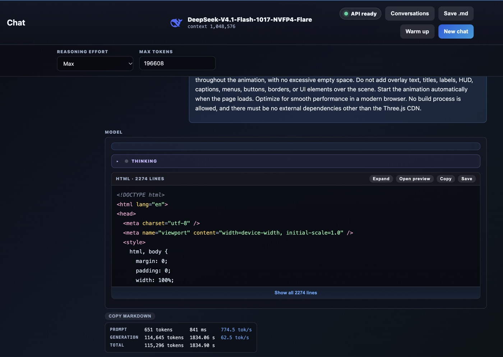
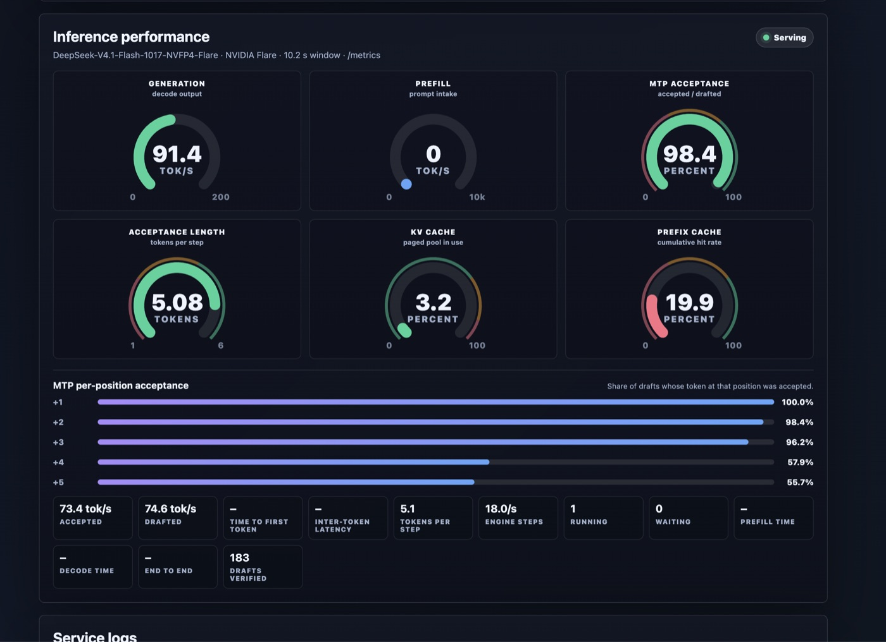

<p align="center">
  
</p>

# DeepSeek-V4.1-Flash-1017 on NVIDIA Hyperflare, four DGX Sparks

> [!NOTE]
> **Since 2026-11-12 our production card for this model is
> [calvarado2004/deepseek-v41-1017-pico-4x-dgx-spark](https://github.com/calvarado2004/deepseek-v41-1017-pico-4x-dgx-spark)**:
> the same official weights on [pico-dgx-ds4](https://github.com/Picom-code/pico-dgx-ds4), on the
> same four Sparks and the same ring. On the same benchmarks, the same day: one user 84.9 / 143.1
> tok/s chat / code (Hyperflare 49.6 / 99.2), 16 users 361.8 tok/s (192.7), cold prefill 9.3k-9.7k
> tok/s (4.1k-4.3k), needles to 955K on both. This Hyperflare recipe stays as it is and still works.

A recipe that serves DeepSeek's official weights,
[`deepseek-ai/DeepSeek-V4.1-Flash-1017`](https://huggingface.co/deepseek-ai/DeepSeek-V4.1-Flash-1017)
(MXFP4 routed experts, FP8 Engram tables, loaded as published), with
[NVIDIA Hyperflare](https://github.com/NVIDIA/hyperflare-inference) (formerly Flare) at tensor
parallelism 4 on four NVIDIA DGX Sparks (GB10) cabled as a **switchless QSFP
ring**. Ignition prepares a signed runtime package once; the Helios runtime then
runs one rank per Spark, with RoCEnante collectives on the ring cables. 1M-token
context, thinking on by default, tool calls, images, and video (as frames). The
API is OpenAI-compatible.

The same model on the same four Sparks under vLLM is
[calvarado2004/deepseek-v41-1017-nvfp4](https://github.com/calvarado2004/deepseek-v41-1017-nvfp4)
(LibertAIDAI's NVFP4 transcode of these weights).
Hyperflare is faster for one request and for four.

| Measured, one stream unless noted (tok/s) | Hyperflare `7f534bb6` + 0012, chunk 8192 (2026-11-11) | Flare `085ae4a7`, driver 615 (2026-10-30) | Flare `bce032c`, driver 580 (2026-10-25) | Flare `5f37bd1`, LibertAIDAI NVFP4 (2026-10-22) | vLLM recipe |
|---|---:|---:|---:|---:|---:|
| Count to 100 (median of 3; runs) | 124.2 (124.2 / 126.1 / 116.2) | **133.5** (134.2 / 129.7 / 133.5) | 129.2 (120.3 / 129.2 / 129.7) | 98.1 | 81 |
| Code (median of 3; runs) | **115.5** (115.5 / 109.3 / 119.0) | 109.9 (109.9 / 108.2 / 114.1) | 109.3 (91.1 / 110.2 / 109.3) | 89.3 | 75 |
| Prose, English (median of 5; runs) | 60.0 (63.1 / 60.0 / 59.6 / 58.9 / 62.3) | **61.4** (median of 3) | 57.5 (median of 3) | 41.6 | 32 |
| Prose, Spanish (median of 5; runs) | 60.2 (59.5 / 59.5 / 61.6 / 64.6 / 60.2) | **60.6** (median of 3) | 54.4 (median of 3) | 43.9 | – |
| Two prose streams, aggregate (two runs) | **97.1** / 89.2 | 92.0 | 87.0 | 66.8 | – |
| `code_bench`, 1 stream (median of 3; runs) | **96.6** (96.6 / 99.3 / 88.5) | 94.3 (94.3 / 93.9 / 94.7) | 91.9 (95.2 / 91.9 / 89.5) | 73.8 | 61.2 |
| `code_bench`, 4 streams, aggregate (median of 3; runs) | 185.9 (167.8 / 189.5 / 185.9; 46.5 per stream) | **186.0** (157.9 / 186.0 / 187.3; 46.5 per stream) | 160.2 (160.2 / 159.4 / 172.0; 40.0 per stream) | 84.4 | 126.4 |
| Cold prefill, 20K tokens (tok/s) | **4,281** | 3,621 | 3,737 | 3,344 | ~3,500 |
| Prefill, 82K tokens, Engram rows cold / warm (tok/s; two runs) | **4,096 / 4,069** and 3,589 / 4,625 | 3,479 / 4,025 (chunk 8192, 2026-11-03) | – | – | – |
| Decode profile, code (`tests/profile-decode.py`) | **120.6** tok/s; verify GPU 41.9 ms/round; 85.6% accepted | 108.8 tok/s; 40.8 ms; 78.1% | 43.2 ms; 77.4% | – | – |

`bench.py` rows: 350-word answers at temperature 0, low effort, on an idle card
(prose with 5 runs in the `7f534bb6` column, 3 elsewhere). `code_bench` rows: eight
coding tasks, 512 tokens each (`ignore_eos`), thinking off, temperature 0. Same
settings in all Hyperflare/Flare columns: adaptive DSpark verification, the Engram
row cache at 6G, and the rendezvous on the fabric (see "Three settings that decide
the speed"). Run-to-run spread is about ±5% on one stream; the two prose-stream and
82K-prefill rows show two runs on the same package because they moved more than that.

**The `7f534bb6` column is the current recipe.** It is upstream main of 2026-11-10
plus one patch (0012), exported with 8,192-token prefill chunks (was 4,096) and 6
request slots (was 4). Against `085ae4a7`, decode is level (code a little faster,
count a little slower, inside the spread). Cold prefill at 20K tokens is 18% faster
(4,281 against 3,621 tok/s); at 82K tokens the gain is +3% to +18% cold and +1% to +15%
warm over the two runs. Against the same pin with 4,096-token chunks, an 82K prefill is +18%
cold and +26% warm (3,041 / 3,669 tok/s). The chunk-8192 package needs patch 0012:
see [The patch](#the-patch).

**Long context** (`7f534bb6` + 0012, one stream, thinking off, a 400-word story
after the context; `bce032c` in brackets):

| Context | Prefix cache | First token | Decode |
|---|---|---:|---:|
| 16 tokens | – | 0.2 s (0.2 s) | 49.8 tok/s (48.5) |
| 99,347 tokens | cold | 23.9 s (24.1 s) | **52.2 tok/s** (44.7) |
| 299,527 tokens | cold | **72.3 s** (78.3 s): 4,143 tok/s prefill | 52.2 tok/s |
| 299,527 tokens | 299,527 cached | **0.2 s** (0.4 s) | 44.7 tok/s (46.7) |

A real chat request on `bce032c` (thinking on, effort Low, 75-token prompt: RSUs
vs stock options, with a four-year vesting table) generated **13,831 tokens in
215.6 s: 64.1 tok/s**, first token in 329 ms.

## Real work: one prompt, one shot

<p align="center">
  
</p>

A single request: a long spec for a **futuristic neon city at night in the rain**
in three.js (thousands of lit windows, holographic billboards, wet reflective
streets, rain, flying-car lanes, fog, and an exact 60-second camera
flythrough), reasoning effort **Max**. The model wrote a 2,274-line page that
runs as is. [`examples/neon-city/`](examples/neon-city/) has the untouched HTML
and a 63-second recording.

| One request, 651-token prompt | |
|---|---:|
| Generated | **114,645 tokens in 30.6 min — 62.5 tok/s average** |
| First token | 841 ms |

<p align="center">
  
  
</p>

The dashboard (right, from a code request on the same card) shows what DSpark
does on code: 5.08 tokens per step and 96–100% acceptance on the first three
draft positions. Free reasoning at temperature 1.0 drafts less well, so the
average over a long Max-effort request is lower than the code-phase peak.

## Quality

| Check (official weights; `7f534bb6` + 0012, chunk 8192, 2026-11-11, unless noted) | Result |
|---|---|
| `tests/smoke.py`: models, count, thinking, tools, forced tool choice, literal image placeholders, `thinking_token_budget`, video | **8/8** |
| `tests/check-unmapped.py` on all four ranks of the package | 0 kernel arguments outside the recorded allocations |
| Cold prompts of 4.1K–20.4K tokens, and a cached 6K-token prefix extended to 8.6K | all pass, no Xid |
| Count to 100, 3 runs | exact 3/3 |
| Deduction puzzle | correct ("dog"), 6,576 tokens, no loops, no foreign script |
| Tool calls, listed and deferred, stream and non-stream | pass |
| Needle in a haystack at 81,920 / 262,144 / 524,288 / 955,000 tokens | found at every length |
| Prefix-cache integrity under concurrency (`guard4`: long documents re-read from the cache, every read checked): 1, 4 and 8 documents at once | **0 bad reads** of 774 (the 8-document stage stopped after 5 of 8 documents) |
| Images, the vLLM recipe's 44-image set (count, OCR, color, chart, spatial, multi-image) | **44/44** (same pin, chunk-4096 package) |
| Cached reads under decode load (`guard5`, cached and one-stream load) | 12/12 each (same pin, chunk-4096 package) |
| Agentic soak (code, ownership, math) | 100% (same pin, chunk-4096 package) |
| Video, a moving object (TLS front frames) | pass |
| Long agent session stays warm (`qualify/prefix_retention.py`, `bce032c` with the earlier patch 0008): a 299.5K-token conversation, then 64 three-turn side conversations (554 snapshot evictions), then a follow-up turn | **299,522 tokens cached, first token in 0.6 s**, recalls the code from the first message |
| Qwen Code, a small car-dealership Python project (LibertAIDAI weights, 2026-10-22) | 18 tool calls, 6 modules, **36/36 tests pass** |

## Hardware

- 4 × DGX Spark (GB10, 128 GB unified memory). Rank 0 needs about 1 TB free
  disk: the checkpoint (475 GiB) and the package (475 GiB). Ranks 1–3 need
  about 261 GiB (280 GB) each: the first start writes their rank of the package
  and the shared data into their own model cache.
- Four QSFP cables in a ring: rank 0 → 1 → 2 → 3 → 0, each cable on its own
  /24. The vLLM recipe's README describes the cabling and addresses we use.
- **NVIDIA driver 615.71.09** on every node. All the numbers since `085ae4a7`
  were measured with it. DGX OS ships R580 (580.178.04), the only driver that
  NVIDIA validates on DGX Spark. On R580, an export of a pin that includes
  `cb6187bf` (2026-10-27, so `7f534bb6` too) fails in "Warm compiled forwards" with
  `Xid 13 ... Illegal Instruction Encoding`
  ([issue #137](https://github.com/NVIDIA/hyperflare-inference/issues/137));
  on 615 the same exports pass. See [Driver 615](#driver-615).
- Ubuntu with CUDA 13.3 (`scripts/build-flare.sh` installs `cuda-toolkit-13-3`
  if missing), and one account (`SPARK_USER`) with passwordless sudo and SSH
  between the nodes. No Docker.

### Driver 615

Ubuntu 24.04 `noble-updates` has the driver and prebuilt kernel modules signed
by Canonical for the DGX OS kernel (7.0.0-1019-nvidia): no DKMS, and Secure Boot
stays on. Stop every model, then on each node:

```bash
sudo apt-get install --no-install-recommends nvidia-driver-615-open \
  "linux-modules-nvidia-615-open-$(uname -r)" linux-modules-nvidia-615-open-nvidia-hwe-24.04
sudo reboot
```

`--no-install-recommends` keeps apt from adding DKMS. After the reboot,
`nvidia-smi` shows 615.71.09 and CUDA 13.4, and `dmesg` has one new line,
`NV_ERR_NOT_SUPPORTED` from `koobInitAperture`, which is harmless. Do one node
first: a card with one node on 615 and three on 580 served and passed
`tests/smoke.py`. To go back, install `nvidia-driver-580-open` and the two 580
module packages, then reboot.

## What the stack is

| Layer | Choice |
|---|---|
| Engine | Hyperflare `7f534bb6` (main, 2026-11-10) + patch 0012 (`patches/`), built from source on each node |
| Driver | NVIDIA 615.71.09 (see [Driver 615](#driver-615)) |
| Package | `ignition export` at TP=4 with `--roce-ring`, max concurrency 6, 5 DSpark drafts, prefill chunk 8,192, csf expert-scale compression; 60–90 min (the first export of a new pin about 2.5 h) |
| Experts | MXFP4, as DeepSeek publishes them (the stock deepseek41 recipe) |
| Engram tables | FP8 E4M3 rows, as published; read from NVMe through a 6G row cache |
| Speculative decoding | DSpark, 5 drafts, adaptive verification (package default) |
| Processes | one systemd unit per rank in the documented manual mode (`docs/multi-host.md`, "Start ranks manually"): rank 0 serves the export's cache entry and sends each peer its ranges at the first start; each rank logs to its own journal |
| Prefix cache | GPU snapshot slots sized from KV memory (about 1,600–1,900 on GB10), least recently used out (upstream #168; no flag) |
| KV cache | about 17–20M tokens across the four GPUs, limited by memory |
| HTTPS | `bin/tls-front.py`: TLS 1.2+ on :8888 in front of Hyperflare's plain HTTP on 127.0.0.1:8001 |
| Start | about 60 s from start to serving; the first start after an export about 6.5 minutes |
| Logs | one `req`/`end` line per request in rank 0's journal, and a flight recorder on every rank (see [Logs](#logs)) |
| Crash recovery | a crash of the serving card restarts all four ranks, at most 3 times in 24 h (see [Crash recovery](#crash-recovery)) |
| Video | the TLS front turns `video_url` parts into timestamped JPEG frames (`bin/dsv41_video_frames.py`, the vLLM recipe's module) |

### The patch

**0012: capture the first serving graph with a graph-pool cuBLAS workspace**
([issue #266](https://github.com/NVIDIA/hyperflare-inference/issues/266)).
Ignition warms every serving graph eagerly in transient storage before it captures
them. PyTorch caches one cuBLAS workspace per handle and stream, so the warm-up
creates it in that transient storage, and the **first** captured graph (the largest
prefill) keeps its address in a cuBLASLt split-K GEMM. Every later capture gets a
workspace from the graph pool, which the export records. The export then releases
the transient storage:

- with 8,192-token chunks, `prefill8192` writes to an unmapped address, and every
  prompt above 7,168 tokens kills all four ranks (`Xid 31 ... FAULT_PDE
  ACCESS_TYPE_VIRT_WRITE`, `CUDA_ERROR_ILLEGAL_ADDRESS`);
- with the default 4,096, a later allocation happens to cover the address, so
  `prefill4096` writes its split-K partials into storage that another allocation
  owns. We saw no wrong output, but the package works by chance.

The patch clears the cached workspaces once, after the warm-ups and before the first
capture (`ignition/preparation/capture.py`, Python only). `tests/check-unmapped.py`
finds this class of fault in a finished package: it decodes every kernel argument
and reports the ones that point outside every recorded allocation (10 on the
unpatched chunk-8192 package, 0 on the patched one).

Upstream `7f534bb6` already carries the fixes of every earlier patch of this recipe:
0004 forced `tool_choice` without thinking (`585702d3`), 0007 literal image
placeholders in request text (`ac7bfa9a`), 0008 snapshot slots under pressure
(`be744283`, #168, slots bounded by KV memory), 0009 parallel re-hash of a peer's
rank at start (`47e92c38`, [#93](https://github.com/NVIDIA/hyperflare-inference/issues/93)),
and before them 0002 (`37c87e1d`), 0003 (`e350914a`), 0005 (`a7d51ca1`) and 0006
(`67ba265e`, `03940fa5`).

## Three settings that decide the speed

1. **The rendezvous must be on the fabric.** The ranks exchange a control
   message every decode round over TCP 29800 on rank 0. Our first run put it on
   Wi-Fi (17–29 ms RTT, 185 ms peaks): 37–61 ms outside the GPU each round, and
   36/33/15 tok/s instead of 98/89/42. `SPARK_HEAD_FABRIC` sets it for the
   systemd ranks and for the export.
2. **Engram row cache.** Without it every row is a direct-I/O NVMe read (7.2 M
   reads, 4.6 ms a gather; the first Flare pin we used had no cache by default).
   Hyperflare defaults to 1 GiB on unified-memory GPUs. `DSV41F_ENGRAM_CACHE=6G`
   keeps about 8 GiB MemAvailable per node.
3. **Keep adaptive verification.** `--no-mtp-adaptive-verification` was slower on
   every bench (code 78.5 vs 89.3, prose 35.6 vs 41.6) and drafts nothing at
   batch > 1.

## Quick start

1. **Edit `cluster.env`**: SSH names of the four nodes in ring order, the head,
   the account, and the fabric addresses (rank 0's, and ranks 1–3 as rank 0
   reaches them).
2. **Build Hyperflare on every node** (run it on the node):
   `scripts/build-flare.sh`. It clones Hyperflare at the pinned commit into its own
   tree (`src-<commit>`) and applies `patches/`.
3. **Fetch the checkpoint** to rank 0: `scripts/fetch.sh`
   (detached; `ssh <head> tail -f logs/fetch-dsv41f.log`). Stop every model on
   the head first: on GB10 page cache is GPU memory.
4. **Export the package** (60–90 min, most of it kernel tuning; about 2.5 h for the
   first export of a new pin; needs all four GPUs): `scripts/export.sh`, then watch
   `~/logs/export-*.log` on the head. It ends with `Exported cache entry: <dir>` in
   rank 0's model cache.
5. **Check the package** on the head, for each rank 0–3:
   `export FLARE_SRC=<src tree>` (as in `pins.env`), then
   `$FLARE_SRC/.venv/bin/python tests/check-unmapped.py <dir> <rank>`.
   It must report 0 unmapped pointer arguments (it exits 1 otherwise).
6. **Share the signing key's profile**: `scripts/publisher.sh` copies the public
   profile of rank 0's development key to every node (no GPU needed).
7. **Stage**: `scripts/stage.sh` (runtime, env, unit). Put a TLS certificate at
   `/etc/ssl/flare/{fullchain,privkey}.pem` on the head, readable by
   `SPARK_USER`, or set `TLS_FRONT_CERT` / `TLS_FRONT_KEY` in the env file.
8. **Start** ranks 1–3, then rank 0:
   `sudo systemctl start spark-llm-dsv41-flare@{1,2,3}` and `…@0`. The first
   start after an export sends each peer its ranges (about 280 GB written and
   read back on each peer: about 6.5 minutes); later starts take about 60 s.
   Rank 0 reports ready when `/health` answers and a warm-up burst is done.
   See [Known gaps](#known-gaps) for the first request after a first start.
   **Moving from `085ae4a7`:** build (step 2) into the new `src-7f534bb6` tree,
   export again (steps 4–5), stage, and start. Rank 0 then has two cache entries, so
   set `DSV41F_PACKAGE` in the env file to the new one (the export log names it).
9. **Test** on the head: `python3 -I tests/smoke.py`, then
   `python3 -I tests/prefill-ladder.py 2000 4000 8000 10000` (cold prompts of about
   4K–20K tokens).

The API is on `https://<head>:8888/v1`, model `DeepSeek-V4.1-Flash-1017-Flare`.
`stage.sh` overwrites the env on the nodes: change `deepseek-v41-1017-flare.env`
here, not on the nodes. Re-export (step 4) after an update that changes the
package format; a new pin refuses an old package with "signed format-6 package
required; re-export the checkpoint".

## Logs

`flare run` prints its start phases and errors only; it has no request log or log
level. The recipe adds two records:

- **Requests**, in rank 0's journal (`journalctl -u spark-llm-dsv41-flare@0`), from
  the TLS front: `req N <client> <path> <bytes> msgs= tools= stream= max_tokens= inflight=`
  when a request goes to Hyperflare, and `end N <status> ttfb= total= out= inflight= prompt=
  completion= cached= [error=...]` when its response ends. The prompt text is never
  logged. `no-response` and `-cut` mark requests that a failure cut off.
- **Flight recorder** (`bin/flare-recorder`), in `/var/log/spark-llm/dsv41-flare/`:
  `metrics-YYYYMMDD.jsonl` on rank 0 every 5 s (the `flare_*` series and how long
  `/metrics` took to answer: a stalled rank 0 shows as a slow or failed sample), and
  `host-YYYYMMDD.jsonl` on every rank every 60 s plus once after the rank exits
  (memory, pressure, the rank process, fabric PHY and RDMA error counters, GPU clocks
  and throttle reasons). Counters are totals: diff two records. Older days are gzipped;
  files go after 14 days.

## Crash recovery

A crash of one rank stops all four (see [Known gaps](#known-gaps)). Rank 0's unit has
`OnFailure=spark-llm-dsv41-flare-recover.service` (a drop-in on rank 0 only), which runs
`bin/recover-card` as `SPARK_USER`. It waits 20 s, then starts ranks 1–3 and rank 0 again,
only when all of these hold:

- the card was serving: a run that failed during its start stays down, so a broken
  start cannot loop;
- nothing was stopping it: a stop job on rank 0 or on any peer means a stop, not a
  crash (a plain `systemctl stop` of rank 0 ends "Deactivated successfully" and never
  triggers it);
- fewer than `DSV41F_RECOVER_MAX` (3) restarts in the last `DSV41F_RECOVER_WINDOW`
  (24 h): the next crash stays down for a person.

It checks again after the 20 s wait, so a stop in that time cancels the restart. Every
decision is in `journalctl -u spark-llm-dsv41-flare-recover` and in
`/var/log/spark-llm/dsv41-flare/recover.log`; the restarts in the window are in
`restarts.txt` next to it. `DSV41F_RECOVER_MAX=0` turns it off. Tested on the four
Sparks: `kill -9` of rank 0 was serving again in 99 s; a stop left all four down.
Rank 0 reaches ranks 1–3 over SSH as `SPARK_USER` (`SPARK_RECOVER_PEERS` in
`cluster.env` if their names differ from the head).

## Requests

- Thinking is on by default. `reasoning_effort` takes `low`, `high`, `xhigh`,
  `max`; Hyperflare rejects `none`.
- Thinking off: `"chat_template_kwargs": {"enable_thinking": false}`. Hyperflare
  rejects template keys it does not know (vLLM's `thinking` is one).
- `thinking_token_budget` is a hard limit on the reasoning tokens (upstream #167), and
  `usage.completion_tokens_details.reasoning_tokens` counts them (#170).
- The model card's sampling is temperature 1.0, top_p 1.0 (upstream fixes top_p at
  1.0 for this model, #208); send it from the client (at lower temperatures V4.1 can
  loop in its reasoning).
- `tool_choice: "required"` works with and without thinking.
- Video: a `video_url` part with a `data:` URL or an http(s) URL, and optional
  `num_frames` / `fps`. Frames count as images; a bad or unreadable clip gets
  HTTP 400 from the TLS front.

## Known gaps

- **The first request after the first start of a new export can fail.** On both
  packages we exported on 2026-11-11, the first request after the first start (the
  one that sends the peers their ranges) failed with `RoCE collective on rank 3 timed
  out waiting for rank 0 ... at sequence 2987; the transport is poisoned`, with no Xid,
  after `NV_ERR_NO_MEMORY` in rank 0's kernel log during that start. Crash recovery
  restarted the card in about 60 s, and every start after that served normally. The
  cause is open; restart all ranks once after the first start of a new package
  before you send traffic.
- **Prefix reuse** happens at message boundaries only.
- **A stall on one rank stops all four.** If a rank does not reach a collective in
  time, its neighbor reports `RoCE collective on rank A timed out waiting for rank B
  ... the transport is poisoned`, and every rank exits. There is no recovery for
  this (`docs/roce-ring.md`): start all ranks again. We saw it once in service, after
  18.7 hours up, with clean links, NIC counters and host memory; the cause is open.
  The logs above are there to catch the next one, and [crash recovery](#crash-recovery)
  starts the ranks again.
- Hyperflare's docs call physical ring cabling and full-model ring serving
  "unqualified". This recipe is a community result on that path, not an NVIDIA
  configuration.

## Repository layout

```
bin/launch-rank                 one rank: flare run with the recipe's settings; rank 0 adds HTTP and the TLS front
bin/tls-front.py                TLS on :8888, video parts become frames, one req/end log line per request
bin/flare-recorder              flight recorder: /metrics (rank 0) and host state (every rank) to /var/log/spark-llm/dsv41-flare
bin/recover-card                crash recovery on rank 0: restart all ranks, at most 3 times in 24 h
bin/dsv41_video_frames.py       the frame sampler (from the vLLM recipe)
patches/                        0012 for Hyperflare 7f534bb6 (see NOTICE)
scripts/build-flare.sh          build patched Hyperflare on one node
scripts/fetch.sh                the official checkpoint to rank 0
scripts/export.sh               four-rank ignition export / join into rank 0's model cache
scripts/publisher.sh            the development key's public profile to every node
scripts/stage.sh                bin, env and unit to the four nodes
systemd/                        the Type=notify unit, one rank per node (no [Install]: never start at boot), and rank 0's recovery unit and drop-in
tests/smoke.py                  eight one-request checks
tests/check-unmapped.py         kernel arguments of a package that point outside every recorded allocation
tests/prefill-ladder.py         cold prompts of rising size; stops at the first failure
tests/chunk-probe.py            cold prompts and cached-prefix extensions of a given size
tests/profile-decode.py         per-round wall time vs GPU time of one decode
examples/neon-city/             a one-shot run: untouched output, recording
cluster.env                     your nodes
deepseek-v41-1017-flare.env     every knob, with the measured reason for its value
pins.env                        checkpoint revision, Hyperflare commit, paths
```

## Credits

- **NVIDIA** — Hyperflare (formerly Flare): Ignition, Helios, RoCEnante, DSpark support.
- **dbotwinick** — the shared-memory fix on issue #2 and issue #7 (earlier
  patches 0002 and 0003, upstream now).
- **Martin Vit** — PR #75, the terminal-snapshot fix (earlier patch 0005).
- **DeepSeek** — the model, its weights and DSpark.
- **LibertAIDAI** — the NVFP4 checkpoint that earlier versions of this recipe served.

## License

The recipe's own files are MIT (`LICENSE`). The patch is a change to Hyperflare and
keeps its license (Apache-2.0); see `NOTICE`. The DeepSeek logo
(`assets/deepseek-logo.svg`, from
[Wikimedia Commons](https://commons.wikimedia.org/wiki/File:DeepSeek_logo.svg),
MIT, originally from deepseek-ai) is a trademark of DeepSeek. This is an
independent community recipe, not affiliated with or endorsed by DeepSeek or
NVIDIA.
