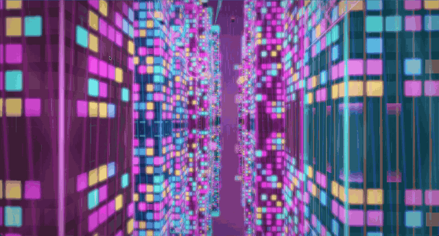

# Neon city — one prompt, one shot

Produced by this recipe in a single request: a long spec for a self-contained
three.js page with a futuristic neon city at night in the rain (dense lit towers,
holographic billboards with no readable text, wet reflective streets, rain
streaks and splashes, flying-car lanes, fog and searchlights), and an exact
60-second camera flythrough that loops. Reasoning effort **Max**, `max_tokens`
196,608. No edits: [`neon-city.html`](neon-city.html) is the answer exactly as
the model wrote it (2,274 lines; three.js from a CDN is the only dependency).
Open it in a browser.

| | |
|---|---:|
| Prompt | 651 tokens, first token after 841 ms |
| Generated | **114,645 tokens in 1,834.1 s — 62.5 tok/s average** |

[`demo.mp4`](demo.mp4) is a 63-second screen recording of the page.

